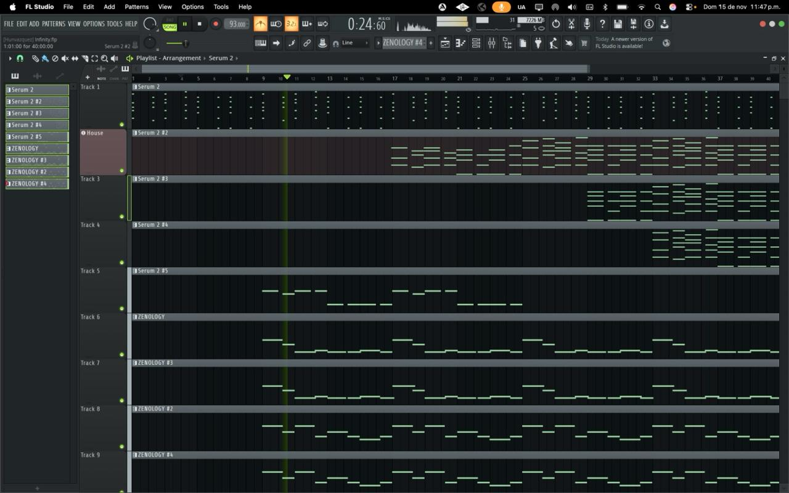

# Music and sound

## What the game has
- **Music:** our own song, "Alone in Space with Only Your Decisions" (`game/assets/audio/music.mp3`). It plays in a gapless loop for the whole game and gets quieter during storms. The build embeds it in `dist/mars-outpost.html`, so the single file works offline. If the file cannot load, the game plays a calm loop made in code.
- **Sound effects**, made in code with the Web Audio API (`game/src/ui/audio.js`): a tap sound, an event alarm, a soft neutral chime after every choice (no choice sounds like a mistake), a failure sound for Game Over and a launch sound.
- **Controls:** an always-visible mute button and a low default volume, because the audience is kids aged 7–12, sometimes in a classroom. The mute choice is remembered in the browser (`localStorage`).
- Browsers block audio until the player taps something, so the music starts after the first tap ("Start my mission").

## How the song was made
The song was produced by the team in FL Studio. Screenshot of the arrangement:

## Change the song
Replace `game/assets/audio/music.mp3` with a file of the same name and run `npm run build` inside `game/`. Keep the file small (the current one is 128 kbps) so the game loads fast.
